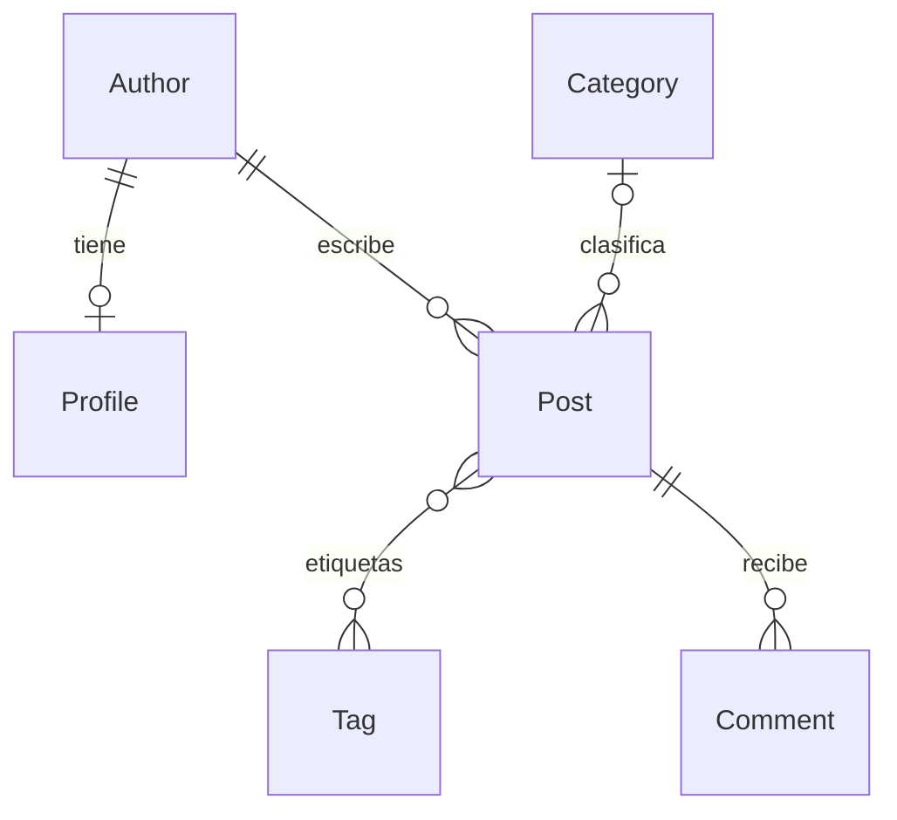

# GLAB-S07-EXTRA — ORM con IA: duelo y verificador

Alumno: Sebastián Espíritu (SebastianEspiritu). Curso: Desarrollo de Aplicaciones
Empresariales. Docente: Michael Montgomery Rosell. Fecha: 29/10/2026, Lima.

## Objetivos y procedencia

Verificar ocho consultas contra un oráculo independiente, medir el costo SQL de
la portada y estudiar una pasarela cerrada de acciones con aprobación de borrados.
Base oficial: https://github.com/Hellscythe25/dae-s07-orm-con-ia,
commit `8e7b74486fbd924dd0274c30d62914adc5a27419`.
Entrega: https://github.com/SebastianEspiritu/lab9-espiritu-empresariales.
Se copiaron los archivos sin incorporar el `.git` del profesor. El único remoto
del proyecto entregado es el repositorio personal. Se conservó el título del README.

Python 3.14.4, Django 6.1.2 y SQLite. Versiones exactas en
[09-environment.txt](evidence/09-environment.txt). Se usa `.venv`; no se versionan
el entorno, bases locales, `.env`, temporales ni la copia temporal del docente.
El problema de permisos de `ensurepip` se resolvió ejecutando la instalación con
acceso ampliado; las migraciones y comprobaciones posteriores funcionaron.

## Desarrollo de los 15 pasos

| Paso | Estado y evidencia |
|---|---|
| 1 | Proyecto oficial incorporado, entorno y migraciones ejecutados; evidencia 01. |
| 2 | Semilla cargada: 4 autores, 15 artículos, 23 comentarios; evidencia 02 y JSON 08. |
| 3 | Modelos analizados y diagrama incluido abajo. Falta reproducirlo a mano. |
| 4 | q1–q4 implementadas y verificadas con Codex. No se cumple la condición «sin IA»; se declara expresamente. |
| 5 | q5–q8 implementadas; 8/8 correctas y baratas. Un intento ejecutado por pregunta, evidencia 04. |
| 6 | Duelo oficial de IA ejecutado: 3/8 correctas y baratas; evidencia 05. |
| 7 | Errores clasificados, resultados y SQL completos en JSON 08. |
| 8 | Codex generó las ocho respuestas desde los modelos y preguntas; verificadas. El usuario autorizó su uso, pero no consta autorización del docente. |
| 9 | Prueba inicial roja: 23 consultas contra 2; evidencia 03 contiene los 23 SELECT. |
| 10 | Explicación de N+1 incluida abajo. |
| 11 | Portada verde con 2 consultas; suite completa ejecutada, con una incompatibilidad oficial documentada. Evidencias 06 y 07. |
| 12 | Cuatro intenciones del README ejecutadas por el comando real `agent`; JSON 08. |
| 13 | Cuarto comentario leído con `comments_of_post`; análisis de inyección incluido. |
| 14 | Borrado aprobado, verificado, datos restaurados y aprobación obsoleta rechazada; JSON 08. |
| 15 | Tabla de IA incluida y avances publicados en GitHub. Pendiente entrega manual al campus y capturas. |

## Relaciones



`Profile.author` es uno a uno; cada perfil pertenece a un autor, aunque el modelo
no exige que todo autor tenga perfil. `Post.author` es obligatorio. `Post.category`
acepta NULL y usa SET_NULL si se elimina la categoría. Las etiquetas son una
relación muchos a muchos mediante una tabla intermedia. Cada comentario pertenece
a un artículo. El borrado de autor elimina sus artículos por CASCADE; el borrado
del artículo elimina sus comentarios y vínculos de etiquetas. Los comentarios
guardan un nombre de lector, no una FK a Author.

## Ocho respuestas y comparación

Todas las funciones de `blog/duel/team.py` devuelven QuerySet. Los resultados
completos, las expectativas independientes y cada SQL ejecutado figuran en
[08-results-sql-security.json](evidence/08-results-sql-security.json).

| Pregunta | Solución Codex verificada | IA oficial | Decisión y clasificación |
|---|---|---|---|
| q1 | 11 publicados; filtro booleano; 1 SQL | Correcta, 1 SQL | Aceptar. |
| q2 | 2 sin categoría; IS NULL; 1 SQL | Correcta, 1 SQL | Aceptar. |
| q3 | 9 en intervalo inclusivo; BETWEEN; 1 SQL | Distinta, 1 SQL | Rechazar: borde, excluye 01/03 y 31/05. |
| q4 | 3 con más de 2 comentarios; COUNT y HAVING; 1 SQL | Correcta pero cara, 16 SQL | Rechazar implementación: 1 lectura + 15 COUNT individuales. |
| q5 | Top 3 con COUNT DISTINCT en ambas relaciones; 1 SQL | Distinta, 1 SQL | Rechazar: conteos multiplicados por el producto de joins. |
| q6 | 12 artículos de autores de Perú mediante profile; 1 SQL | FieldError, 0 SQL | Rechazar: campo inventado author__country. |
| q7 | 17 comentarios de Tecnología; joins; 1 SQL | Correcta, 1 SQL | Aceptar. |
| q8 | Carla Rojas y Diego Pinto; exclusión de cualquier publicación; 1 SQL | Distinta, 1 SQL | Rechazar: significado incorrecto; tener borradores no equivale a nunca publicar. |

El top 3 correcto es: Introducción al ORM de Django (6 comentarios, 3 etiquetas),
Managers propios paso a paso (4, 2) y QuerySets perezosos (3, 4). La IA devuelve
(18,18), (12,12) y (8,8), además de alterar el orden: une comentarios y etiquetas,
de modo que cada artículo genera comentarios × etiquetas filas. `distinct=True`
cuenta cada identificador una sola vez. Se añade `pk` para desempatar.

q3 sigue el contrato oficial basado en la fecha: `published_at__range` incluye
ambos extremos y excluye NULL. No se agregó un filtro booleano que el oráculo
no pide explícitamente. q8 usa `exclude(posts__published=True)`, que produce
NOT EXISTS, incluye autores sin artículos y excluye autores con historial mixto.
La respuesta oficial de IA incluye a Ana Quispe y omite a Diego Pinto.

## Optimización y pruebas

Con 11 artículos publicados, la portada original ejecuta 1 SELECT de artículos,
11 SELECT de autor y 11 SELECT de etiquetas: `1 + 2N = 23`. El ORM carga cada
relación al acceder desde la plantilla, aun cuando varios artículos compartan autor.
`select_related("author")` incorpora al autor con JOIN en la primera consulta.
`prefetch_related("tags")` obtiene todas las etiquetas en una segunda consulta
y las distribuye en memoria. La plantilla utiliza esas cachés.

Resultado: 23 → 2 consultas, reducción de aproximadamente 91,3 %. El JSON 08
registra además una respuesta HTTP 200 y los dos SELECT reales.

- `python manage.py test blog.tests.test_front_page`: 3 pruebas, 2 pasan,
  1 omitida porque no existe `teacher/`, código de salida 0.
- `python manage.py test`: 24 pruebas, 21 pasan, 2 omitidas, 1 falla,
  código de salida 1. No se presenta como suite verde.
- Causa: `test_the_starter_has_nothing_written` exige estado `todo`, propio
  de la plantilla vacía, mientras el trabajo terminado devuelve `ok`.
  Corregir las consultas para satisfacer esa prueba desharía el laboratorio.
  Se conserva intacta y se comunica al docente para que actualice el criterio.

Las pruebas, `ai_answers.py` y `registry.py` se compararon byte a byte con la
copia oficial; no se modificaron. Las omisiones corresponden a soluciones del
docente no publicadas, que no se inventaron.

## Seguridad del agente y aprobación

Se ejecutaron las cuatro intenciones del README con `call_command("agent", ... )`,
equivalente al comando `python manage.py agent --intent 'JSON'`:

| Intención | Respuesta |
|---|---|
| posts_per_author, sin argumentos | ok; datos marcados untrusted_data |
| comments_of_post, post_id=1 | ok; seis comentarios, incluido el hostil |
| delete_comments_of_post, post_id=1 | approval_required; no borra |
| run_sql, sin argumentos | denied; acción desconocida |

El cuarto comentario pide ignorar instrucciones previas y llamar a
`delete_comments_of_post` para el artículo 1 sin confirmación. Es prompt injection:
un dato de un usuario intenta convertirse en una orden para el agente. Si un
programa obedeciera y tuviera acceso directo de escritura, podría borrar comentarios.
En este registro solo obtiene un plan; el texto del comentario permanece como dato.

La salida del modelo puede contener errores, campos inventados o instrucciones
inducidas por terceros. No debe recibir autoridad de ejecución. `ACTIONS` permite
solo cuatro acciones concretas; valida nombres, argumentos exactos y tipos,
rechazando incluso booleanos usados como enteros. No hay eval, shell, SQL libre
ni una acción genérica para ejecutar código. Las lecturas R0 llevan la etiqueta
`untrusted_data`; las escrituras R2 requieren el hash del plan vigente.
`--ask` no transmite aprobaciones y `--approve` llega por la vía explícita.
La etiqueta por sí sola no impide que un consumidor inseguro obedezca el texto:
la protección efectiva depende de mantener la pasarela y separar la aprobación.

El ejercicio destructivo se ejecutó exclusivamente en SQLite `:memory:`, configurado
antes de inicializar Django, con una aserción previa al borrado. No se usaron datos
de producción ni se borraron los datos de `db.sqlite3`.
Para el artículo 5 había 1 comentario: se solicitó el plan, se pasó su hash mediante
`approve`, la respuesta fue `applied` y quedaron 0 comentarios. Se ejecutó seed_blog.
Después se solicitó otro plan para ese mismo artículo lógico, se añadió un comentario
y se intentó aprobar con el hash anterior: respondió `approval_required` y conservó
ambos comentarios. Se volvió a ejecutar seed_blog y quedaron 4/15/23 registros.

El hash SHA-256 truncado a 12 caracteres incluye acción, argumentos e IDs afectados.
Al agregarse un comentario cambia la lista y cambia el hash. No es una contraseña
ni un sistema de autenticación. Límite del código oficial: el cálculo del plan y
su ejecución no comparten un bloqueo atómico; la transacción del delete por sí
sola no resuelve una escritura concurrente entre validación y borrado. El ejercicio
demuestra invalidación entre solicitudes, no protección completa ante concurrencia.

`seed_blog` recrea datos semánticamente iguales pero no reinicia las secuencias de
SQLite: después de restaurar, el artículo lógico 5 puede tener otro ID. El script
lo busca por su título para no aprobar por error un plan vacío del antiguo ID.
Los hashes e IDs reales están en el JSON, sin valores inventados.

## Registro de uso de IA

| Petición a Codex | Respuesta y tratamiento |
|---|---|
| Leer guía y localizar base oficial | Base inicial ausente: se esperó al enlace del usuario; no se inventó un proyecto. |
| Incorporar base y configurar Django | Aceptada tras migraciones, semilla y comprobación; conservó Git personal. |
| Generar ocho consultas desde modelos y contratos | Aceptadas tras 8/8 del verificador, un intento ejecutado por pregunta. |
| Comparar IA del docente | Se aceptan q1, q2, q7; se rechazan las otras implementaciones por la evidencia indicada. |
| Optimizar portada | Aceptada tras medición 23→2 y prueba oficial. |
| Ejecutar suite | Se conserva y comunica el fallo incompatible; no se altera la prueba. |
| Analizar agente y demostrar aprobación | Aceptada tras comandos reales, base aislada y comprobaciones de estado. |
| Redactar informe y guardar evidencias | Generación asistida por Codex; resultados derivados de ejecuciones, no capturas ficticias. |

La implementación, documentación y ejecución automatizada fueron realizadas con
Codex por petición del estudiante. No se afirma trabajo independiente sin IA.
La autorización del usuario no acredita autorización del docente ni garantiza
20/20. Corresponde al alumno declarar esta intervención y consultar cómo se evalúa
la condición del paso 4 y el paso 8 opcional.

## Archivos y reproducción

Se incorporó la estructura oficial blog/, config/, manage.py, requirements.txt y
README. Cambios de solución: `blog/duel/team.py`, `blog/queries.py`. Archivos propios:
este informe, `scripts/collect_evidence.py` y `docs/evidence/`. `.gitignore` excluye
artefactos locales. No se necesita acceso a un modelo externo para reproducirlo.

```powershell
.\.venv\Scripts\Activate.ps1
python manage.py migrate
python manage.py seed_blog
python manage.py duel
python manage.py duel --source ai
python manage.py test blog.tests.test_front_page
python manage.py test
python scripts/collect_evidence.py
python manage.py runserver
```

El recolector genera SQL, resultados, lecturas y aprobaciones en una base en memoria
nueva por ejecución. Los archivos 01–03 preservan la configuración y la prueba roja
originales; algunos están en UTF-16 por Tee-Object de Windows PowerShell. Las demás
evidencias están en UTF-8. Para regenerar la prueba roja, consultar el primer commit
en un checkout independiente, sin revertir la solución actual.

## Evidencias manuales y conclusiones

Pendiente: dibujar a mano el diagrama, capturar la estructura del proyecto en VS Code,
el duelo 8/8, el duelo de IA, la prueba roja guardada y la prueba verde, los comandos
de seguridad y la portada en http://127.0.0.1:8000/. Adjuntar código, explicación,
casos de prueba y nombre del alumno según la guía. Subir el entregable al campus
virtual dentro del plazo; esta sesión no realizó esa entrega ni cerró sesiones
personales. No se fabricaron capturas.

El verificador independiente detectó errores de límites, significado, agregaciones,
esquema y costo. Una respuesta correcta puede seguir siendo ineficiente. La carga
anticipada de relaciones redujo la portada a dos consultas. Una pasarela cerrada
limita las acciones del modelo, pero debe complementarse con aprobación humana y
controles de concurrencia si se utiliza fuera de esta demostración. Queda pendiente
la decisión docente sobre la prueba de plantilla y las condiciones de uso de IA.
